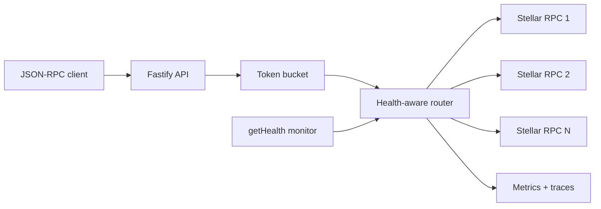

# Resilient RPC Gateway

A production-minded, observable multi-upstream gateway for Stellar JSON-RPC. It keeps read traffic available when an RPC provider is slow or unavailable, while deliberately avoiding unsafe retries for transaction submission.

> Portfolio status: `v0.1.0` MVP. The implementation is intentionally small enough to review, but includes the failure handling, telemetry, tests, and operational documentation expected from infrastructure software.

## Why this exists

Applications commonly depend on one hosted RPC URL. That endpoint becomes a hidden single point of failure: a timeout blocks every request, a degraded provider increases tail latency, and indiscriminate retries can duplicate side effects.

This gateway provides:

- latency- and reliability-aware endpoint selection;
- bounded timeouts and exponential backoff with jitter;
- per-endpoint circuit breakers with half-open recovery;
- retries across different upstreams for safe methods;
- **no automatic retry for `sendTransaction`**;
- periodic Stellar `getHealth` probes;
- per-client token-bucket rate limiting;
- structured request logs with secret-safe endpoint identifiers;
- Prometheus process, request, retry, latency, score, and circuit metrics;
- OpenTelemetry spans through an optional OTLP HTTP exporter.

## Architecture



The client cannot choose an upstream URL. Upstreams are operator-controlled configuration, which avoids turning the gateway into an SSRF proxy.

## One-command failure demo

Requirements: Docker with Compose.

```bash
make demo
```

This starts a fast mock RPC, a slower upstream that fails every third request, and the gateway on `localhost:8080`.

```bash
curl -s http://localhost:8080/rpc \
  -H 'content-type: application/json' \
  -d '{"jsonrpc":"2.0","id":1,"method":"getLatestLedger"}'

curl -s http://localhost:8080/health | jq
curl -s http://localhost:8080/metrics | grep rpc_gateway
npm run benchmark
```

## Local development

Node.js 22 or newer is required.

```bash
cp .env.example .env
npm ci
npm run dev
```

For a real deployment, set `RPC_ENDPOINTS` to two or more RPC URLs you operate or trust. URL credentials are never returned by the health API or used as metric labels.

## HTTP surface

| Route          | Purpose                                                              |
| -------------- | -------------------------------------------------------------------- |
| `POST /rpc`    | Validated JSON-RPC 2.0 proxy; single requests and notifications      |
| `GET /health`  | Sanitized endpoint states, health scores, latency and failure counts |
| `GET /ready`   | Kubernetes-compatible readiness response (`200` or `503`)            |
| `GET /metrics` | Prometheus exposition format                                         |

Successful RPC responses include `x-rpc-endpoint` and `x-rpc-attempts`. These contain an internal identifier such as `rpc-2`, never the configured URL.

JSON-RPC batch requests are intentionally out of scope for `v0.1.0`; they are rejected as invalid instead of being partially or ambiguously processed.

## Retry policy

| Situation                                             | Retry?                       | Circuit health impact      |
| ----------------------------------------------------- | ---------------------------- | -------------------------- |
| timeout, network failure, HTTP `408`, `429`, or `5xx` | Yes, on a different endpoint | failure                    |
| invalid upstream JSON                                 | Yes                          | failure                    |
| other upstream `4xx`                                  | No                           | neutral                    |
| JSON-RPC error inside a successful HTTP response      | No                           | success at transport layer |
| `sendTransaction` transport failure                   | **Never automatically**      | failure                    |

This policy optimizes availability without pretending that every RPC method is idempotent. See [ADR-0001](docs/adr/0001-retry-safety.md).

## Configuration

| Variable                       |            Default | Meaning                                                   |
| ------------------------------ | -----------------: | --------------------------------------------------------- |
| `RPC_ENDPOINTS`                |           required | Comma-separated HTTP(S) upstream URLs                     |
| `HOST` / `PORT`                | `0.0.0.0` / `8080` | Listen address                                            |
| `REQUEST_TIMEOUT_MS`           |             `2500` | Per-attempt deadline                                      |
| `MAX_RETRIES`                  |                `2` | Additional attempts for retry-safe methods                |
| `RETRY_BASE_DELAY_MS`          |               `50` | Exponential backoff base                                  |
| `CIRCUIT_FAILURE_THRESHOLD`    |                `3` | Consecutive failures before opening                       |
| `CIRCUIT_OPEN_MS`              |            `30000` | Cooldown before a half-open probe                         |
| `HEALTH_PROBE_INTERVAL_MS`     |            `10000` | Stellar `getHealth` probe interval                        |
| `RATE_LIMIT_CAPACITY`          |              `100` | Maximum burst tokens per client                           |
| `RATE_LIMIT_REFILL_PER_SECOND` |               `20` | Sustained token refill rate                               |
| `OTEL_EXPORTER_OTLP_ENDPOINT`  |              unset | OTLP HTTP trace endpoint, normally ending in `/v1/traces` |

Rate-limit identity uses a SHA-256 digest of `x-api-key`, or the source IP when no key is supplied. Raw API keys are not logged, labeled, or stored.

## Health scoring

Each upstream receives a `0–100` selection score based on circuit state, success ratio, EWMA latency, consecutive failures, and current in-flight load. The router selects the highest-ranked available endpoint and excludes already-attempted endpoints from the same client request.

Prometheus metrics include:

- `rpc_gateway_requests_total`
- `rpc_gateway_request_duration_seconds`
- `rpc_gateway_request_attempts`
- `rpc_gateway_upstream_attempts_total`
- `rpc_gateway_upstream_duration_seconds`
- `rpc_gateway_endpoint_health_score`
- `rpc_gateway_endpoint_circuit_state`
- `rpc_gateway_rate_limited_total`

The example Prometheus scrape configuration is in [`config/prometheus.yml`](config/prometheus.yml).

## Quality gates

```bash
npm run check
```

The check runs strict TypeScript, ESLint, formatting, unit/integration tests with coverage thresholds, and a production build. CI additionally runs `npm audit` and builds the Docker image.

The test suite covers failover, retry safety, circuit transitions, rate-limit refill, health probes, HTTP errors, readiness, and metrics. No real network is required.

## Operations and security

- [Threat model](docs/threat-model.md)
- [Runbook: all upstreams unavailable](docs/runbooks/all-upstreams-unavailable.md)
- [Runbook: elevated latency](docs/runbooks/elevated-latency.md)
- [ADR-0001: retry safety](docs/adr/0001-retry-safety.md)
- [ADR-0002: endpoint selection](docs/adr/0002-health-aware-selection.md)
- [GitHub launch plan](docs/github-launch-plan.md)

## Known limits

- The MVP is a single process; rate-limit state is not shared across replicas.
- Authentication and per-tenant quotas belong at an ingress/API-management layer.
- Endpoint-specific headers are not yet configurable.
- Batch JSON-RPC and WebSocket subscriptions are not supported.
- Health scores reset on restart and are not intended as long-term SLO storage.

These constraints are explicit so that future changes can be evaluated against real requirements rather than hidden assumptions.

## License

MIT — see [LICENSE](LICENSE).
